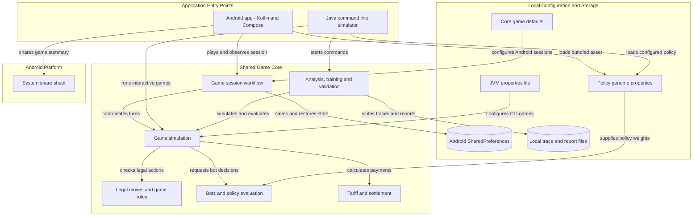
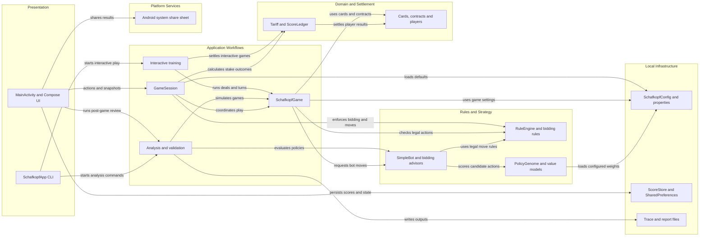

# Architecture Diagram

Schafkopf is an offline card-game simulator with a Java game core shared by a command-line application and a Kotlin Android app. The CLI can load local properties, Android uses core defaults and a bundled policy genome, and game state is persisted on-device.

## Application Architecture

<!-- mermaid-checked: no \n, no em-dash/en-dash, no {} in labels, subgraphs are id["label"], arrows are |"label"|, all subgraphs closed by end, ids unique -->

### Technology Stack Summary

| Layer | Technology | Version | Purpose |
| --- | --- | --- | --- |
| Android presentation | Kotlin, Jetpack Compose, Material 3 | Kotlin 2.2.20; Compose BOM 2025.10.00 | Single-activity game interface, interaction, animation, and result display |
| Android platform | Android SDK | Compile/target 36; minimum 26 | Device lifecycle, local assets, preferences, and system share sheet |
| Shared game core | Java | Maven release 21; Android source/target 17 | Game model, rule enforcement, session flow, bots, and settlement |
| JVM application | Java and Maven | Java 21; Maven Compiler Plugin 3.13.0 | CLI simulator, training, analysis, evolution, and validation commands |
| Android build | Android Gradle Plugin and Gradle Kotlin DSL | AGP 8.13.2; Kotlin plugin 2.2.20 | Android packaging and compilation of the shared Java sources |
| Core tests | JUnit Jupiter | 5.10.2 | Unit and regression tests for the Java core |
| Android tests | JUnit | 4.13.2 | Local unit tests for Android-side behavior |

### Data Storage & External Services

The Android app uses `SharedPreferences` for score totals, pending stock, pre-session deal state, and the serialized active session. It loads the policy genome from bundled properties assets; the CLI reads properties and genome files from the local filesystem and writes decision traces and analysis outputs locally. There is no database, network API, message broker, or remote service configured. Sharing a result invokes the Android system share sheet and is an optional operating-system handoff.

### Key Architectural Decisions

- The Java game core is compiled both as a Java 21 Maven application and as Java 17-compatible source inside the Android app.
- Legal move generation and contract rules are deterministic core responsibilities; bots choose among legal actions using policy weights and strategy code.
- Android persistence is a local adapter around serialized session state and scores; the core does not depend on Android storage APIs.

## Component Relationships

<!-- mermaid-checked: no \n, no em-dash/en-dash, no {} in labels, subgraphs are id["label"], arrows are -->|"label"|, all subgraphs closed by end, ids unique -->

### Component Inventory

| Component | Layer | Type | Responsibility |
| --- | --- | --- | --- |
| `MainActivity` and Compose UI | Presentation | Android activity and composables | Drives the Android deal, bidding, play, review, persistence, and result display |
| `SchafkopfApp` | Presentation | Java CLI entry point | Routes play, simulation, training, calibration, evolution, and validation commands |
| `GameSession` | Application | Session coordinator | Maintains Android-facing game stages, snapshots, bidding, actions, and serialization |
| `SchafkopfGame` | Application | Game engine | Runs deals, contract play, trick progression, game results, and bot turns |
| Interactive training | Application | Workflow module | Runs console games and updates the player ledger |
| Analysis and validation | Application | Workflow module | Simulates, reviews, calibrates, evolves, and validates policies and recorded games |
| `RuleEngine` and `GameBiddingRules` | Rules and Strategy | Rule modules | Determines legal card actions and allowed contract ranking |
| `SimpleBot` and bidding advisors | Rules and Strategy | Decision modules | Selects legal card and contract actions using tactical strategies |
| `PolicyGenome` and value models | Rules and Strategy | Policy modules | Stores feature weights and contract value estimates used by bot decisions |
| Cards, contracts and players | Domain | Domain model | Represents cards, hands, players, contracts, tricks, and outcomes |
| `Tariff` and `ScoreLedger` | Domain and Settlement | Settlement modules | Calculates game payments and tracks balances and role statistics |
| `SchafkopfConfig` and properties | Infrastructure | Configuration module | Loads game options and tariffs from properties with defaults |
| `ScoreStore` and SharedPreferences | Infrastructure | Android persistence adapter | Persists Android scores, pending deals, stock, and active session state |
| Trace and report files | Infrastructure | Filesystem output | Stores decision traces, generated policy files, and analysis reports |
| Android system share sheet | Platform Services | Operating-system integration | Hands a game summary to an available Android sharing target |